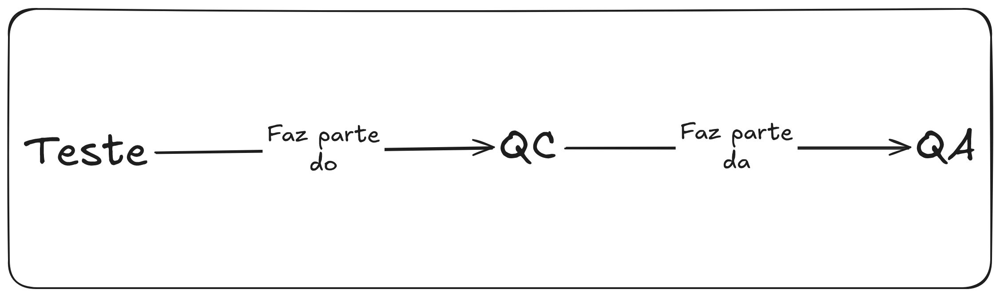
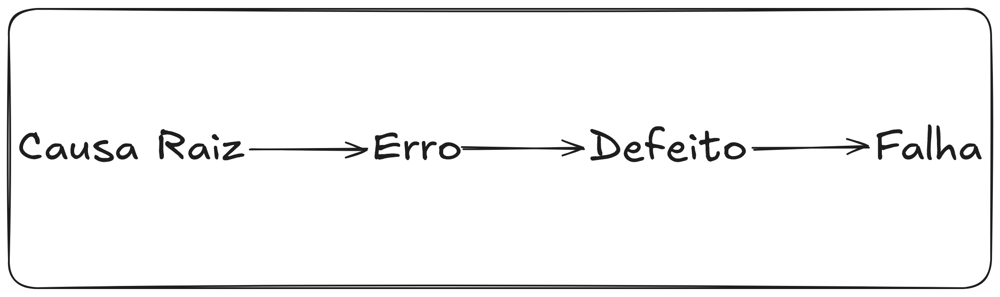

#  1. Fundamentos de teste

## 1.1 O que é teste?

- **Teste de software:** Conjunto de atividades para descobrir defeitos e avaliar a qualidade dos Artefatos de Software.
    - **Artefatos de software:** São os objetos de teste.
        - **Objetos de teste:** Artefatos de software quando estão sendo testados.

- Os testes de software **verificam** e **validam** os objetos de teste.
    - **Verificação:** Verifica se o sistema atende aos requisitos especificados. "O sistema está construído corretamente?"
    - **Validação:** Checa se o sistema atende as necessidades dos usuários e outros stakeholders em ambiente operacional. "O sistema é útil e eficaz?"
    ```
    Exemplo para compreender melhor Verificação vs Validação (Busca em um E-Commerce):

        - Requisito: Ao digitar o termo e clicar em "Buscar", o sistema deve retornar itens que contenham a palavra buscada no seu título.

        --> Verificação: Você testa, digita "camisa" e o sistema retorna 50 itens. A verificação passou, a regra foi seguida.
        --> Validação: Na verdade, o usuário quer encontrar camisas azuis e sejam tamanho "M". Se a busca é só por título, sem filtros e tamanho ou cor, ela não atende a necessidade real do usuário. Portanto, nesse caso a validação falhou!
    ```

- Os testes podem ser:
    - **Dinâmicos:**
        - Envolve a execução do  software;
        - Usam diferentes tipos de técnicas de testes e abordagens de teste para derivar casos de teste;
        - Objetivo: Validar comportamento do software, medir performance e garantir que as funcionalidades atendam às necessidades do usuário;
        - Exemplos:
            - Testes unitários;
            - Testes de integração;
            - Testes de API;
            - Testes de Interface (UI).
    - **Estáticos:**
        - Não envolve a execução do software;
        - Foca em revisões e análises estáticas de documentos e do código fonte para encontrar **defeitos** ANTES do programa rodar;
        - Objetivo: Encontrar defeitos na lógica, inconsistências em requisitos ou violações de padrões de código;
        - Exemplos:
            - Revisão de requisitos;
            - Code Review;
            - Análise estática por ferramentas (Exemplo: SonarQube).

- Os testes não são apenas uma atividade técnica! Eles precisam ser:
    - Planejados: Objetivos e abordagem (estratégia);
    - Estimados: Prever esforço, tempo e recursos necessários;
    - Monitorados: Comparar progresso real com o planejado;
    - Controlados: Tomar ações corretivas baseadas no monitoramento;
    - Gerenciados: Coordenação das atividades e interface com o time.

- O teste é, em grande parte, uma atividade **intelectual**. Exige que o testador tenha:
    - Conhecimento especializado;
    - Use habilidades analíticas;
    - Aplique pensamento crítico e sistêmico.

- A norma **ISO/IEC/IEEE 29119-1** fornece mais informações sobre conceitos de teste de software.

### 1.1.1 Objetivos do teste

Os objetivos **típicos** do teste são:
- Avaliar produtos de trabalho (requisitos, User Stories, projetos e código);
- Detectar falhas e defeitos;
- Garantir cobertura necessária
- Verificar se os requisitos foram atendidos;
- Conformidade com requisitos contratuais, legais e normativos;
- Fornecer informações aos stakeholders;
- Criar confiança na qualidade do software;
- Validar se software está completo e funcionando como esperado. 

> OBS: típicos pois podem variar! Dependem de contexto do produto, nível, riscos...

###  1.1.2 Teste e depuração

- Teste e depuração são atividades **distintas!**
- O teste pode:
    - Desencadear falhas causadas por defeitos no software (Teste Dinâmico);
    - Ou encontrar defeitos diretamente no objeto de teste (Teste Estático).
- Mais sobre testes dinâmicos e estáticos:
    - Teste dinâmico:
        - Desencadear falhas;
        - A falha aparece pois você "cutucou" o defeito através de uma execução;
        - O código roda, a falha aparece;
        - Você encontra falhas (sintomas);
        - Mostra que o sistema está quebrado.
    - Teste estático:
        - Não executa o código (inspeção);
        - Você encontra defeitos (causas);
        - Te mostra onde o sistema vai quebrar.

    ```
    Exemplo para compreender melhor testes dinâmicos vs testes estáticos (Ponte com rachadura):

        --> Teste dinâmico: você coloca o carro pro cima da ponte (executa o software). Se a ponte cair, você presenciou uma FALHA;
        --> Teste estático: Um engenheiro vai até a ponte com uma lanterna e olha para os pilares. Ele vê a rachadura (DEFEITO) antes de qualquer carro passar.
    ```

- Depuração (não é uma atividade de teste):
    - Quando o **teste dinâmico** aciona uma falha, a depuração se preocupa em:
        - Encontrar as causas dessa falha (encontrar o defeito);
        - Analisar essas causas;
        - Eliminá-las.
        > O processo típico da depuração nesse caso envolve:
        > - Reproduzir a falha;
        > - Diagnosticar (Encontrar a **causa raiz**);
        > - Corrigir a causa.
    - Quando o **teste estático** identifica um defeito, a depuração se preocupa em removê-lo.
        > Não há necessidade de reprodução ou diagnóstico pois o teste estático encontra defeitos diretamente e **não pode causar falhas**.

## 1.2 Porque os testes são necessários?

- Os testes ajudam a atingir objetivos acordados dentro do escopo, do tempo, da qualidade e das restrições financeiras;
- A contribuição dos testes **NÃO deve se restringir à equipe de testes**.
    > Qualquer stakeholder pode usar as suas habilidades para contribuir.

### 1.2.1 Contribuições para o sucesso dos testes

- O teste fornece um meio econômico de detectar defeitos;
    - Esses defeitos podem então serem removidos (são removidos por **depuração**, que lembrando não é uma atividade de teste);
        - Dessa maneira, o teste contribui de **INDIRETAMENTE para objetos de teste de maior qualidade.**
            - O teste aponta defeitos, o desenvolvimento depura e corrige.
- O teste fornece um meio de avaliar diretamente a qualidade de um objeto de teste em vários estágios do SDLC (Software Development Life Cycle, ou Ciclo de Vida do Desenvolvimento de Software);
    - Contribui para as decisões de passar para o próximo estágio do SDLC, como a decisão de liberação.
- Os testes oferecem aos usuários uma representação indireta do projeto;
    - Os testadores garantem que o seu entendimento das necessidades dos usuários seja considerado  em todo o ciclo de vida do desenvolvimento.
- Os testes também podem ser necessários para atender a requisitos contratuais ou legais, ou para cumprir normas obrigatórias.
    - Exemplo: Gerar evidências para auditorias.
    > Teste não é "só achar bug", é também atender a uma conformidade.

### 1.2.2 Testes e Garantia de Qualidade (QA)

- Teste e QA (Quality Assurance, ou Garantia de Qualidade) **NÃO são a mesma coisa**.
    - O teste é uma forma de QC (Quality Control, ou Controle de Qualidade).
    


- Garantia de Qualidade (QA):
    - Abordagem preventiva;
    - Orientada para o processo;
    - Foco na implementação e no aprimoramento dos processos;
    - Se um bom processo for seguido corretamente ele vai gerar um bom produto;
    - QA se aplica aos processos de desenvolvimento e teste, é responsabilidade de **todos** em um produto.

- Controle de Qualidade (QC):
    - Abordagem corretiva;
    - Orientada para o produto;
    - Foco nas atividades que apoiam a obtenção de níveis adequados de qualidade;
    - Testes são uma das principais formas de QC.

    ```
    Exemplo para compreender melhor QA vs QC (PFábrica de Pizzas):

        -> QA: Não olha para a pizza que acabou de sair do forno, se preocupa como a pizza é feita.
            --> Foco: Processo;
            --> Ação: "Precisamos garantir que o forno seja limpo todas as manhãs e que os ingredientes usados sejam sempre frescos.";
            --> No software: Quando você define que "Todo código deve passar por um code review" ou "precisamos de requisitos claros antes de começar a codificar.";
            --> Objetivo: Evitar que o problema aconteça. Se o processo for bom, o produto tende a ser bom.


        -> QC: É o inspetor que fica no final da esteira olhando a pizza pronta.
            --> Foco: O produto (Código, APP, API ou no nosso exemplo, a pizza!);
            --> Ação: "Essa pizza está queimada e não pode ser entregue ao cliente, vamos precisar jogar fora e fazer outra.";
            --> No software: É o ato de testar! Abrir o Postman ou um código automatizado, rodar o teste e ver se o status code veio 200 ou 500. Se veio errado, reportar o erro para ser corrigido;
            --> Objetivo: Identifica o defeito no produto já criado e garantir que ele seja corrigido antes de chegar ao usuário.
    ```

### 1.2.3 Erros, defeitos, falhas e causas-raiz



- Causa Raiz (O "porquê" original)
    - É o motivo fundamental. Se você resolver isso, evita que novos erros  parecidos aconteçam;
    - Ocorre no processo ou ambiente.
    
    ```
    Exemplo:

        -> "Porque o dev errou o cálculo?"
            --> Porque o documento de requisitos estava confuso;
                ---> A falta de clareza no requisito é a causa-raiz. Se você melhorar o requisito, os desenvolvedores tendem a não cometerem mais o erro;
    ```

- Erro (O equívoco humano):
    - O erro (equívoco) acontece na cabeça do ser humano, é uma ação ou decisão incorreta;
    - Ocorre na mente de quem está trabalhando;
    - Humanos cometem erros por vários motivos, como:
        - Pressão de tempo;
        - Complexidade dos produtos de trabalho;
        - Processos;
        - Infraestrutura ou interações;
        - Cansaço;
        - Falta de treinamento adequado.
    
    ```
    Exemplo:

        -> O desenvolvedor está com sono (causa-raiz) e pensa que o imposto deve ser somado, quando deveria ser subtraído.
            --> O ato de digitar o sinal de "+" invés de "-" é o erro.
    ```

- Defeito (O bug no papel/código):
    - O defeito (Bug) é o resultado físico do erro (equívoco). É a prova do crime que ficou registrada no sistema ou documento;
    - ocorre no código fonte, nos requisitos, no script de teste;


    ```
    Exemplo:

        -> A linha de código "total = valor + imposto" (quando o certo seria "total = valor - imposto").
            --> O defeito está lá, "parado", mesmo que ninguém rode/execute o programa.
    ```

- Falha (O comportamento errado):
    - A falha é quando o sistema "pifa" ou faz algo que o usuário não queria. É o evento visível;
    - Ocorre durante a execução (Teste dinâmico);
    - IMPORTANTE: 
        - Um defeito pode ficar "escondido" e nunca gerar uma falha se aquela parte do código nunca for executada;
        - Testes estático **NÃO** podem causar falhas! Falhas só ocorrem durante a execução do código durante o teste dinâmico.
            - Se não tem execução, não tem como o sistema se comportar de forma errado e, portanto, não existe falha;
            > Lembre-se que os testes estáticos encontram defeitos diretamente no artefatos (requisitos, código e etc) sem rodar o sistema, então você apenas lê e encontra o defeito antes que ele seja executado.


    ```
    Exemplo:
    
        -> O cliente fecha a compra e o sistema cobra R$110 em vez de R$90.
            --> O cliente vê o valor errado na tela, isso é uma falha.
    ```

## 1.3 Princípios de teste

**1 - O teste mostra a presença, não a ausência de defeitos.**
- Testes reduzem a probabilidade de defeitos não serem descobertos, mas mesmo que nenhum defeito seja encontrado, os testes não podem provar que o objeto de teste está 100% correto.

**2 - Testes exaustivos são impossíveis**
- Testar tudo é inviável, escolha o que é mais importante;
- Use as técnicas de teste, a priorização de casos e os testes baseados em riscos para concentrar esforços;
- Exceção: Casos triviais (simples), como testar uma função liga e desliga.

**3 - Testes antecipados economizam tempo e dinheiro.**
- Quando mais cedo o teste começa, mais barato fica o conserto;
- Testes estáticos e dinâmicos devem ser iniciados o mais cedo possível.

**4 - Os defeitos se agrupam.**
- A maioria dos erros ficam em poucos módulos;
- Princípio de Pareto (80/20): 80% dos problemas estão em 20% do código.

**5 - Os testes se degradam.**
- Se os mesmos testes forem repetidos muitas vezes, eles se tornarão ineficazes para encontrar novos defeitos;
- Igual um inseticida em que os insetos vão ficando imunes com o tempo;
- É preciso atualizar ou criar novos testes;
- Em alguns casos a repetição é benéfico, como testes regressivos e automatizados.

**6 - Testes dependem do contexto.**
- Os testes são feitos de forma diferente em contextos diferentes;
- A estratégia muda conforme o sistema.

**7 - Falácia da ausência de erros.**

- É errado esperar que a verificação do software garanta o sucesso do sistema. Além da verificação, a validação também deve ser realizada.

    > **Resumindo:** Não adianta que o software não tenha erros se ele não faz o que o usuário precisa, ou até mesmo se ninguém consegue usar.

## 1.4 Atividades de teste, Testware e papéis no teste

- Sabemos que o teste depende de contexto (Princípio 6), mas há um conjunto de atividades comuns de teste que sem elas é menos provável que os testes atinjam seus objetivos.
    - Esse conjunto de atividades formam o **Processo de Teste**;
    - A norma ISO/IEC/IEEE 29119-2 fornece informações sobre processos de teste.

### 1.4.1 Atividades e Tarefas de teste

- **Planejamento do teste:** Definir objetivos e a estratégia.
    - Aqui é decidido "onde se quer chegar".

- **Monitoramento de teste e controle:** Verificar se o que foi planejado está acontecendo (monitoramento). Se algo sair dos trilhos, ações são tomadas (controle).
    - **Monitoramento:** Envolve verificar continuamente as atividades de teste e comparar o progresso real com o plano;
    - **Controle:** Tomada de ações necessárias para atingir os objetivos do teste.

- **Análise de teste:** Olhar requisitos para identificar o que pode ser testado, além de identificar riscos e condições de teste.
    - "O que precisa ser testado?"

- **Modelagem de teste:** Elaboração dos casos de teste, o desenho do roteiro. Aqui é definido ambiente e os dados necessários.
    - "Como testar?"
    > Observação: Modelagem de teste também é conhecida como "Projeto de teste" (nomenclatura antiga).

- **Implementação do teste:** Criação ou aquisição do material de teste necessário para a execução.
    - O preparar, deixar tudo pronto para "rodar" o teste;
    - "Temos o que precisamos para começar a rodar?".

- **Execução do teste:** Rodar os testes (manual ou automático) e comparar o que aconteceu com o que era esperado.
    - "O sistema se comportou como deveria?".

- **Conclusão de teste:** Criar relatório final, ver quais bugs ficaram abertos e o que aprendemos para a próxima vez.
    - "O que entregamos e o que podemos melhorar para o próximo ciclo?".

    > Observação: Não necessariamente essas atividades seguem uma sequência lógica, geralmente são implementadas de forma iterativa ou paralela.